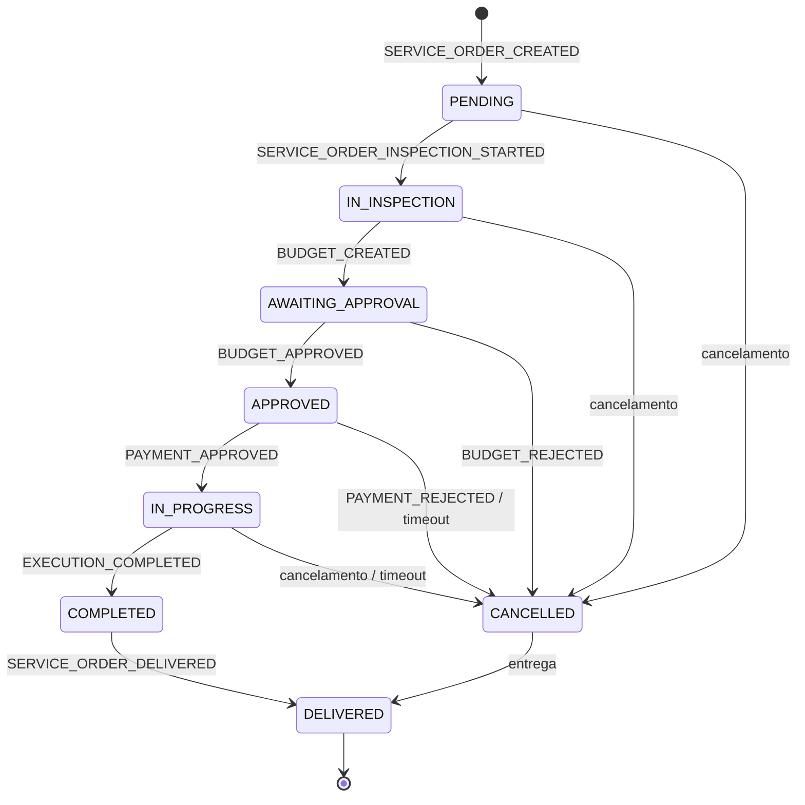

# Contratos de Eventos

Documento de referência dos eventos trocados entre os microsserviços.
Fonte de verdade para produtores e consumidores. Alterações são **aditivas** (ver
[Versionamento](#versionamento)); mudanças incompatíveis exigem novo `type`/`version`.

## Escopo

| Serviço                | Papel                                                                                          |
|------------------------|------------------------------------------------------------------------------------------------|
| `ms-pedidos`           | Dono da Ordem de Serviço (OS). **Único** serviço que altera o status da OS.                    |
| `ms-orcamentos`        | Orçamento, decisão do cliente, pagamento (Mercado Pago) e reembolso.                           |
| `ms-expedicao`         | Fila de execução, diagnóstico/reparo e conclusão.                                              |
| `mnl-oficina-mecanica` | Cadastros, autenticação, catálogo, almoxarifado e relatórios. Não participa do Saga de status. |

## Envelope

Todo evento usa o mesmo envelope. O `payload` varia por `type`.

```json
{
  "eventId": "0192f3a4-5b6c-7d8e-9f00-112233445566",
  "type": "SERVICE_ORDER_CREATED",
  "version": 1,
  "occurredAt": "2026-10-17T12:00:00Z",
  "correlationId": "3f2504e0-4f89-41d3-9a0c-0305e82c3301",
  "causationId": null,
  "aggregateId": "42",
  "payload": {
    "serviceOrderId": 42,
    "filialId": 1,
    "ownerId": 7,
    "vehicleId": 15,
    "description": "Revisão de 20.000 km",
    "catalogServiceIds": [
      3,
      8
    ],
    "createdAt": "2026-10-17T12:00:00Z"
  }
}
```

| Campo           | Tipo           | Regra                                                                              |
|-----------------|----------------|------------------------------------------------------------------------------------|
| `eventId`       | UUID           | Único por evento. Chave de idempotência dos consumidores.                          |
| `type`          | enum           | Valor do enum Java `EventType`, serializado em `UPPER_SNAKE_CASE`.                 |
| `version`       | inteiro        | Versão do payload daquele `type`. Inicia em `1`.                                   |
| `occurredAt`    | ISO-8601 UTC   | Momento da produção do evento.                                                     |
| `correlationId` | UUID           | Identifica o fluxo da OS. Propaga por HTTP (`traceparent`) e por todos os eventos. |
| `causationId`   | UUID ou `null` | `eventId` do evento que causou este. `null` no primeiro evento do fluxo.           |
| `aggregateId`   | string         | Id do agregado de origem. Na prática, o `serviceOrderId`.                          |
| `payload`       | objeto         | Campos específicos do `type`.                                                      |

## Tópicos

Organização **por serviço produtor** (topic-per-service), em kebab-case.

| Tópico                     | Produtor        | Consumidores                    |
|----------------------------|-----------------|---------------------------------|
| `service-order-events`     | `ms-pedidos`    | `ms-orcamentos`, `ms-expedicao` |
| `budget-events`            | `ms-orcamentos` | `ms-pedidos`                    |
| `execution-events`         | `ms-expedicao`  | `ms-pedidos`                    |
| `service-order-events.dlt` | —               | operação                        |
| `budget-events.dlt`        | —               | operação                        |
| `execution-events.dlt`     | —               | operação                        |

Regras:

- **Chave da mensagem:** `serviceOrderId` como string. Garante ordenação por OS dentro da partição.
- **Retenção:** 7 dias. Sem compactação (log de eventos).
- **Partições:** definidas por ambiente; a ordenação relevante é por OS, garantida pela chave.
- **Tópicos legados:** `budget-approval-request` e `budget-decision` são substituídos por
  `budget-events` por estes contratos. Código novo não deve publicar nem consumir os tópicos legados.

## Catálogo de eventos

### `ms-pedidos` → `service-order-events`

| `type`                             | Consumidores    | Transição da OS                            | Payload                                                                                               |
|------------------------------------|-----------------|--------------------------------------------|-------------------------------------------------------------------------------------------------------|
| `SERVICE_ORDER_CREATED`            | `ms-orcamentos` | → `PENDING`                                | `serviceOrderId`, `filialId`, `ownerId`, `vehicleId`, `description`, `catalogServiceIds`, `createdAt` |
| `SERVICE_ORDER_INSPECTION_STARTED` | `ms-orcamentos` | → `IN_INSPECTION`                          | `serviceOrderId`, `filialId`, `startedAt`                                                             |
| `SERVICE_ORDER_APPROVED`           | —               | `AWAITING_APPROVAL` → `APPROVED`           | `serviceOrderId`, `filialId`, `budgetId`, `approvedAt`                                                |
| `SERVICE_ORDER_IN_PROGRESS`        | `ms-expedicao`  | `APPROVED` → `IN_PROGRESS`                 | `serviceOrderId`, `filialId`, `paymentId`, `startedAt`                                                |
| `SERVICE_ORDER_COMPLETED`          | —               | `IN_PROGRESS` → `COMPLETED`                | `serviceOrderId`, `completedAt`                                                                       |
| `SERVICE_ORDER_DELIVERED`          | —               | `COMPLETED` → `DELIVERED`                  | `serviceOrderId`, `deliveredAt`                                                                       |
| `SERVICE_ORDER_CANCELLED`          | `ms-orcamentos` | qualquer transição permitida → `CANCELLED` | `serviceOrderId`, `previousStatus`, `reason`, `cancelledAt`                                           |

### `ms-orcamentos` → `budget-events`

| `type`             | Consumidores | Transição da OS                   | Payload                                                                       |
|--------------------|--------------|-----------------------------------|-------------------------------------------------------------------------------|
| `BUDGET_CREATED`   | `ms-pedidos` | → `AWAITING_APPROVAL`             | `serviceOrderId`, `filialId`, `budgetId`, `totalAmount`, `currency`, `sentAt` |
| `BUDGET_APPROVED`  | `ms-pedidos` | `AWAITING_APPROVAL` → `APPROVED`  | `serviceOrderId`, `budgetId`, `decidedAt`                                     |
| `BUDGET_REJECTED`  | `ms-pedidos` | `AWAITING_APPROVAL` → `CANCELLED` | `serviceOrderId`, `budgetId`, `reason`, `decidedAt`                           |
| `PAYMENT_APPROVED` | `ms-pedidos` | `APPROVED` → `IN_PROGRESS`        | `serviceOrderId`, `paymentId`, `amount`, `currency`, `paidAt`                 |
| `PAYMENT_REJECTED` | `ms-pedidos` | `APPROVED` → `CANCELLED`          | `serviceOrderId`, `paymentId`, `reason`, `rejectedAt`                         |
| `PAYMENT_REFUNDED` | `ms-pedidos` | — (sem transição)                 | `serviceOrderId`, `paymentId`, `refundId`, `refundedAt`                       |

### `ms-expedicao` → `execution-events`

| `type`                | Consumidores | Transição da OS             | Payload                                                    |
|-----------------------|--------------|-----------------------------|------------------------------------------------------------|
| `EXECUTION_COMPLETED` | `ms-pedidos` | `IN_PROGRESS` → `COMPLETED` | `serviceOrderId`, `filialId`, `executionId`, `completedAt` |

### Comandos em `service-order-events`

Comandos usam o mesmo envelope; o `type` indica a intenção.

| `type`                     | Consumidor      | Payload                                                                      |
|----------------------------|-----------------|------------------------------------------------------------------------------|
| `PAYMENT_REFUND_REQUESTED` | `ms-orcamentos` | `serviceOrderId`, `paymentId`, `amount`, `currency`, `reason`, `requestedAt` |

> Comandos não alteram o status da OS diretamente. Quem altera status é sempre o `ms-pedidos`.

## Máquina de estados da OS

Somente os estados existentes no domínio são usados. `PARTIALLY_REJECTED` permanece
fora de escopo (placeholder 501).



| Evento                             | Transição                             |
|------------------------------------|---------------------------------------|
| `SERVICE_ORDER_CREATED`            | → `PENDING`                           |
| `SERVICE_ORDER_INSPECTION_STARTED` | `PENDING` → `IN_INSPECTION`           |
| `BUDGET_CREATED`                   | `IN_INSPECTION` → `AWAITING_APPROVAL` |
| `BUDGET_APPROVED`                  | `AWAITING_APPROVAL` → `APPROVED`      |
| `BUDGET_REJECTED`                  | `AWAITING_APPROVAL` → `CANCELLED`     |
| `PAYMENT_APPROVED`                 | `APPROVED` → `IN_PROGRESS`            |
| `PAYMENT_REJECTED`                 | `APPROVED` → `CANCELLED`              |
| `EXECUTION_COMPLETED`              | `IN_PROGRESS` → `COMPLETED`           |
| `SERVICE_ORDER_DELIVERED`          | `COMPLETED` → `DELIVERED`             |

> **Pagamento bloqueia execução.** A OS só avança para `IN_PROGRESS` após
> `PAYMENT_APPROVED`. Não existe estado de pagamento: pagamento é pré-condição,
> não estado da OS.
>
> **Falha = cancelamento.** Não existe `EXECUTION_FAILED`. Falha em qualquer etapa
> compensa via `CANCELLED` (e reembolso quando já houve pagamento).

## Versionamento

- Mudanças **aditivas** no payload mantêm o `version` e não quebram consumidores.
- Remoção/renomeação/troca de tipo de campo é **breaking**: cria-se novo `type` (ou
  `version` nova) e publica-se ambos durante a migração.
- Consumidores devem ignorar campos desconhecidos.
- O enum `EventType` no código é espelho deste documento; divergência é bug.

## Idempotência e confiabilidade

- **Outbox transacional** nos serviços Postgres (`ms-pedidos`, `ms-orcamentos`):
  a linha do outbox é gravada na mesma transação do agregado; o Debezium Server
  relaya para o Kafka.
- **DynamoDB Streams → Lambda** publica os eventos do `ms-expedicao`.
- Todo consumidor mantém tabela de deduplicação por `eventId`.
- Consumidores aplicam guarda de estado: evento fora de ordem não gera transição ilegal;
  é registrado e descartado.
- Falha de processamento vai para retry com backoff e, esgotado, para o `*.dlt` do tópico.
- Replay de DLT é permitido e deve ser idempotente.

## Segurança e privacidade

- Nenhum token de aprovação, senha ou dado sensível trafega no evento.
- `serviceOrderId` identifica o agregado; dados pessoais completos não são replicados.
- O acesso aos tópicos é restrito por credenciais de serviço no cluster.

