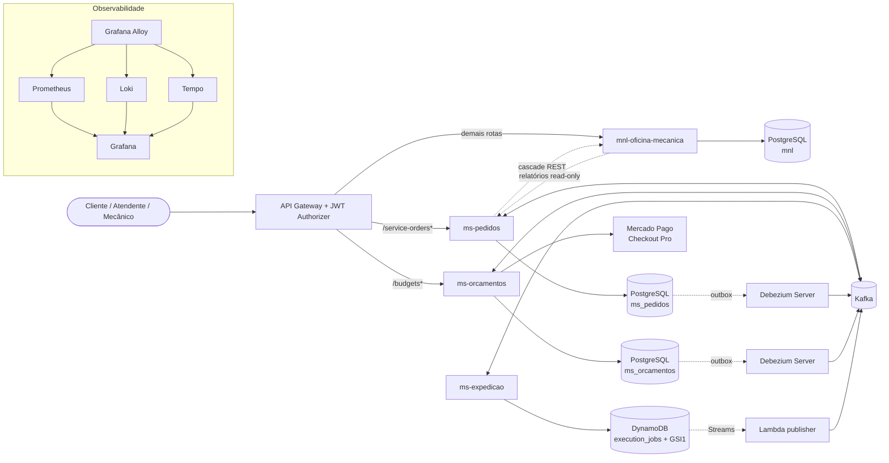
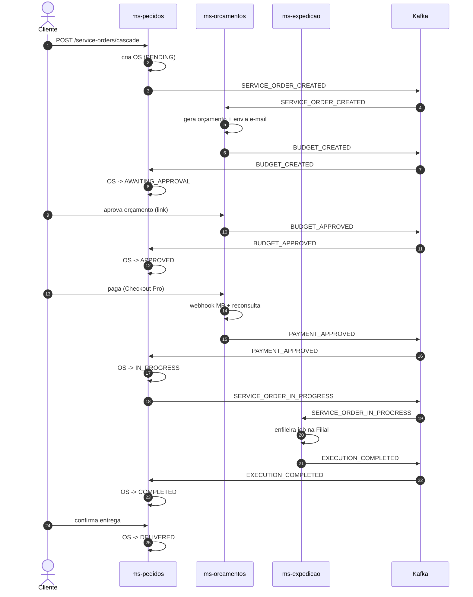
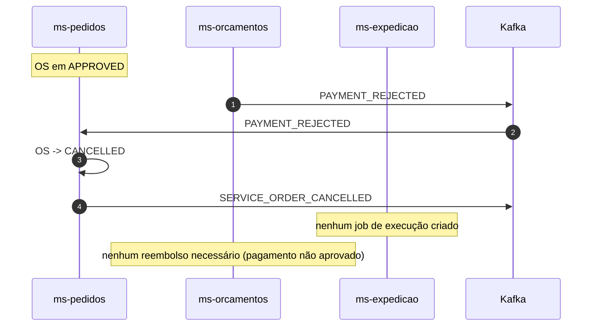
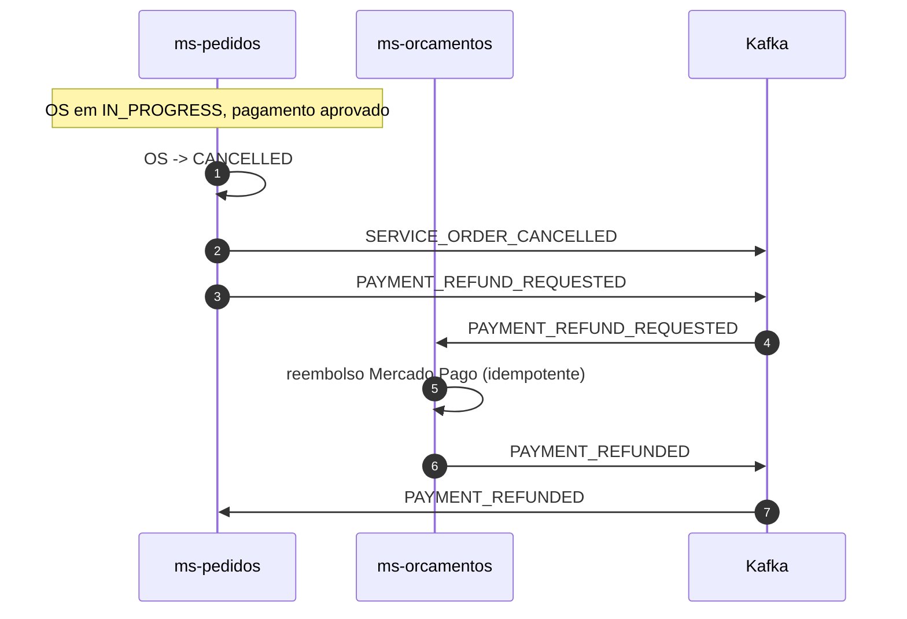
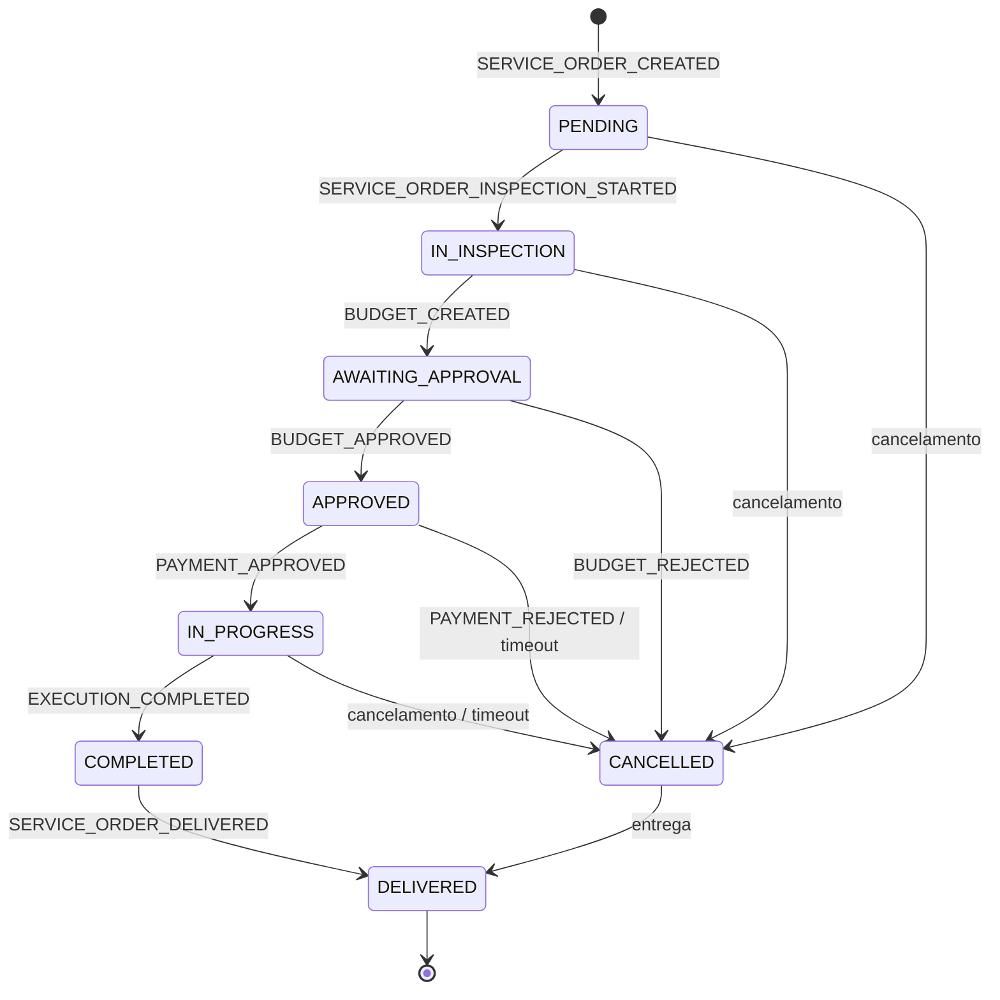
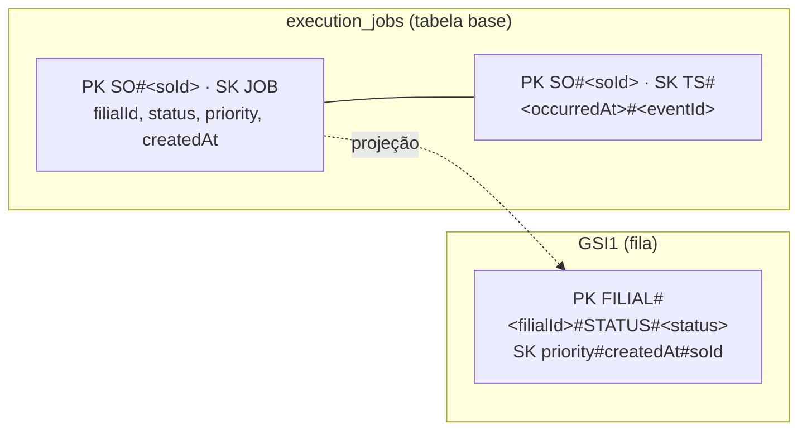

# Diagramas — Arquitetura distribuída

Diagramas em Mermaid (renderizam no GitHub). Complementam o
[catálogo de eventos](../../../events.md) e as ADRs 004–007.

## Arquitetura de serviços

## Fluxo feliz do Saga (coreografado)

## Compensação: pagamento rejeitado

## Compensação: cancelamento após pagamento

## Máquina de estados da OS

> `PARTIALLY_REJECTED` permanece fora de escopo (placeholder 501) e não aparece no fluxo atual.

## Chaves do DynamoDB

